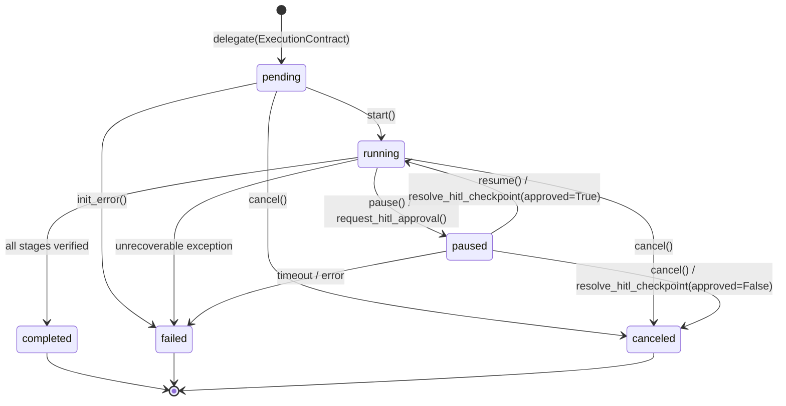

# Background Agent Orchestration (`background-agent-orchestration`)

A deterministic protocol and Python runtime for orchestrating long-running, autonomous background agents from an interactive conversational interface without blocking user turns or flooding chat threads with raw execution logs.

## Installation

### Install as an Agent Skill (`npx skills`)

```bash
npx skills add NoJuanNobody/background-agent-orchestration -g
```

### Install Python Runtime & CLI (`bg-orchestrator`)

```bash
pip install -e .
```

---

## Core Architecture

`background-agent-orchestration` implements five tightly integrated components:

1. **Asynchronous Task Delegation (`ExecutionContract`)**: Packages objectives, ordered stages, priorities (`low`, `normal`, `high`, `critical`), and Human-in-the-Loop (`requires_hitl_at`) gates into validated, serializable contracts.
2. **State & Lifecycle Tracking (`LifecycleStateMachine`)**: Enforces valid transitions across `pending`, `running`, `paused`, `completed`, `failed`, and `canceled` states with full timestamped audit history.
3. **Milestone Progress Reporting (`MilestoneReporter`)**: Ingests noisy execution streams (`DEBUG`/`TRACE`/progress chatter), suppresses low-value log lines, and emits structured `MilestoneEvent` notifications only at stage boundaries or threshold intervals.
4. **Mid-Flight Steering & HITL Checkpoints (`SteeringController`)**: Enables priority shifts, live guidance injection, pause/resume, cancellation, and interactive approval/rejection checkpoints while a background task is in flight.
5. **Synthesis & Artifact Delivery (`ArtifactSynthesizer`)**: Computes SHA-256 checksums for generated deliverables, verifies stage completeness against the contract, and formats concise executive summaries.

---

## Lifecycle State Diagram



---

## CLI Usage (`bg-orchestrator`)

### 1. Run End-to-End Multi-Stage Simulation

Simulates the canonical scenario:
> *"Launch a multi-stage background analysis on our quarterly server access logs, synthesize security anomalies, and keep me posted at major milestones while I continue asking other questions."*

```bash
bg-orchestrator simulate
bg-orchestrator simulate --json
```

### 2. Delegate a Background Task Contract

```bash
bg-orchestrator delegate \
  --objective "Analyze quarterly server access logs and synthesize security anomalies" \
  --stages ingest_logs,correlate_ips,classify_threats,executive_summary \
  --priority high \
  --hitl classify_threats
```

### 3. Check Task Status

```bash
bg-orchestrator status --contract-id bg-q3-sec-01
```

### 4. Steer an In-Flight Task

```bash
# Shift priority mid-flight
bg-orchestrator steer --contract-id bg-q3-sec-01 --action priority --value critical

# Inject mid-flight guidance
bg-orchestrator steer --contract-id bg-q3-sec-01 --action guidance --value "Prioritize port-scan bursts from ASN 64512"

# Approve or reject a pending HITL checkpoint
bg-orchestrator steer --contract-id bg-q3-sec-01 --action approve --value "Approved remediation quarantine list"
```

---

## Running Tests

```bash
pytest -v
```
